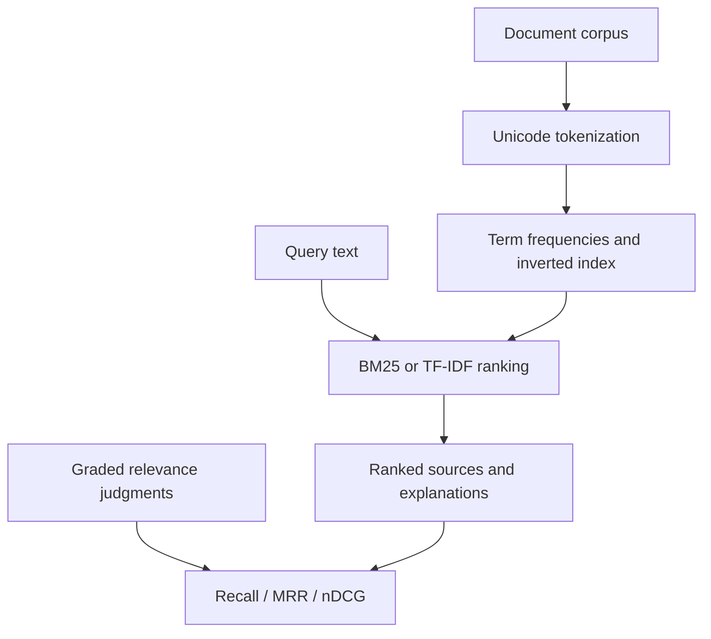

# Evidence Search

### Compare retrieval methods before adding a generation layer.

An inspectable information-retrieval workbench implementing **BM25** and **TF-IDF cosine similarity**, with graded relevance evaluation and per-term score explanations. It runs entirely offline with Python's standard library.

The question is concrete: *does the retriever return the right source material, and can we measure when it does not?* This project isolates that problem before introducing embeddings, a model API, or generated answers.

## Quick start

Requires Python 3.11+. No packages, API keys, or model downloads.

```bash
python search.py query --text "worker lease crash recovery" --method bm25 -k 3
python search.py evaluate --method bm25 -k 3
python search.py evaluate --method tfidf -k 3
python -m unittest discover -s tests -v
```

Results include ranked source text, score, and the contribution of each matched term. Evaluation reports aggregate metrics and per-query rankings rather than a single unexplained score.

## Retrieval pipeline



## What is measured

| Metric | Question |
|---|---|
| Recall@k | What fraction of relevant documents appeared in the top k? |
| MRR@k | How soon did the first relevant result appear? |
| nDCG@k | Did highly relevant documents rank above marginally relevant ones? |

BM25 uses `k1=1.2` and `b=0.75`. TF-IDF uses log-scaled term frequency, smoothed IDF, L2 normalization, and cosine similarity. Ties break by document ID for deterministic output. Terms that occur in no corpus document produce no matches. The returned contributions sum to the final score.

## Bring a corpus

`data/documents.json` is an array of objects:

```json
[{"id":"document-1","text":"Source text to retrieve."}]
```

`data/queries.json` contains queries with document relevance grades from 0 to 3:

```json
[{"id":"query-1","query":"source text","relevant":{"document-1":3}}]
```

```bash
python search.py evaluate --corpus path/to/documents.json --queries path/to/judgments.json --method bm25 -k 10
```

The evaluator rejects unknown document references, duplicate query IDs, invalid grades, and queries with no positive judgment. Unjudged retrieved documents are treated as non-relevant for these metrics.

## Dataset and interpretation

The included corpus has 12 synthetic engineering notes and eight manually specified queries. It is a **smoke-test fixture**, not a representative benchmark or evidence of real-world retrieval quality. The queries overlap strongly with corpus vocabulary. Do not use its scores to claim superiority over semantic search or a production system.

For a credible experiment, supply a domain corpus with independently labeled relevance judgments, separate development and held-out evaluation queries, record a dataset version, and compare both baselines on the same split. Keep parameter tuning off the held-out set.

## Design decisions

- **Lexical baselines first:** cheap, reproducible reference points for future embedding or hybrid experiments.
- **Inverted index:** score only documents containing query terms, rather than scanning every document for every query.
- **Explanations:** surface word-level contributions to investigate false positives.
- **Per-query output:** expose the failures hidden by averaged metrics.
- **No generation:** retrieved source text stays visible and cannot be confused with an unsupported generated answer.

## Verification

Tests cover exact-match ranking under both methods, deterministic ties, score decomposition, cosine bounds, empty and unknown queries, validation, and manually calculable perfect/partial/no-result metrics. CI runs on Python 3.11–3.13.

## Repository guide

| Path | Purpose |
|---|---|
| `search.py` | Indexing, ranking, evaluation, and CLI |
| `data/documents.json` | Small synthetic corpus |
| `data/queries.json` | Graded fixture judgments |
| `tests/` | Ranking, metric, and validation checks |
| `reports/` | Reproducible fixture evaluation output |
| `.github/workflows/` | CI |

## Next experiments

Add a semantic embedding adapter and reciprocal-rank fusion; evaluate on a larger held-out corpus; measure retrieval latency and memory; add passage segmentation and source provenance. Those capabilities are planned, not implemented.
